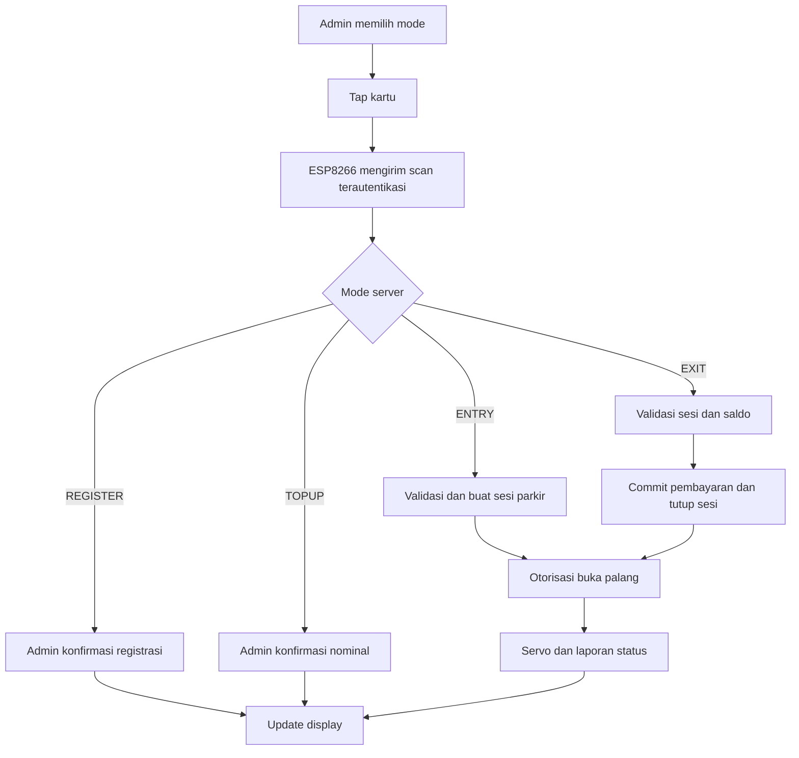
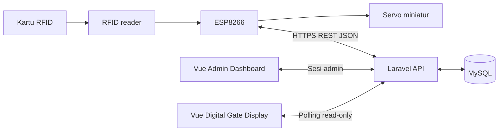
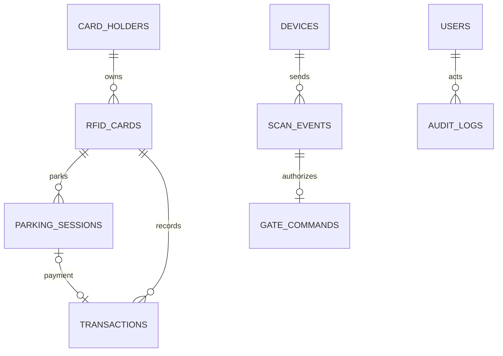

> Implementasi terkini mengikuti konfirmasi pengguna: RC522 RST **D3/GPIO0**, SS D2/GPIO4, servo D1/GPIO5, buka **40°** dan tutup **180°**. Tabel di bawah adalah baseline awal; wiring operasional ada di `docs/WIRING.md`. UI memakai branch `UI/UX`.

# Product Requirements Document (PRD)
## CampusPay — Secure RFID-Based Campus Parking System

| Atribut | Keterangan |
|---|---|
| Versi | 1.0 — baseline MVP |
| Tanggal | 26 November 2026 |
| Mata kuliah | Keamanan Sistem dan Jaringan |
| Studi kasus | Kartu e-Money berbasis RFID/NFC |
| Tim | 5 mahasiswa |
| Status | Rancangan siap ditinjau sebelum implementasi |
| Acuan | Tugas Besar Kuliah (3AEC3(2024)-3AEC4(2024)).pdf, halaman 1, 3–4 |

## 1. Ringkasan produk

CampusPay adalah prototipe sistem parkir kampus dengan pembayaran saldo elektronik simulasi menggunakan kartu RFID. Satu ESP8266, satu RFID reader, dan satu servo digunakan secara bergantian untuk registrasi, top-up, gerbang masuk dan gerbang keluar. Administrator mengoperasikan sistem melalui website; halaman Digital Gate Display menggantikan LCD fisik. Backend menjadi otoritas tunggal untuk saldo, tarif, sesi parkir, dan keputusan membuka palang.

Produk hanya menggunakan kartu uji milik kelompok dan saldo simulasi, bukan kartu uang elektronik bank atau uang sungguhan.

## 2. Latar belakang dan tujuan

Studi kasus meminta pembacaan identitas kartu, penulisan dan penyimpanan data, pengisian saldo, pencatatan waktu masuk/keluar, pemotongan saldo otomatis, serta pengujian keamanan dan validasi transaksi. CampusPay harus membuktikan bahwa akses tidak sah, saldo tidak cukup, transaksi ganda, dan kegagalan transaksi ditangani tanpa merusak konsistensi data.

### 2.1 Sasaran keberhasilan MVP

- Kartu uji dapat dibaca, didaftarkan, dan divalidasi.
- Top-up hanya dapat dilakukan administrator yang terautentikasi dan berwenang.
- Setiap sesi parkir sah memiliki waktu masuk dan, setelah selesai, waktu keluar serta tarif.
- Pembayaran berhasil memotong saldo tepat satu kali; saldo tidak pernah negatif.
- Servo hanya menerima perintah buka untuk transaksi gerbang yang disahkan server.
- Website menampilkan hasil scan dan status perangkat tanpa refresh manual.
- Seluruh skenario wajib pengujian memiliki hasil aktual dan bukti yang dapat ditelusuri.

## 3. Ruang lingkup

### 3.1 Termasuk MVP

Login admin; manajemen pemilik dan kartu; registrasi via scan; top-up; empat mode reader; masuk/keluar; tarif; saldo dan ledger; dashboard; display digital; autentikasi perangkat; audit log; pengujian read/write kartu uji; pengujian keamanan dan integrasi.

### 3.2 Di luar MVP

Payment gateway, uang nyata, integrasi kartu bank, aplikasi Android native, dua gerbang fisik simultan, LCD fisik, tombol fisik, kamera, ANPR, AI, pembayaran offline, dan klaim keamanan setara produk finansial komersial. Sensor kendaraan merupakan pengembangan opsional, bukan syarat prototipe.

### 3.3 Keputusan desain dan asumsi

| Aspek | Baseline |
|---|---|
| Hardware | Opsi A: 1 ESP8266, 1 reader, 1 servo |
| Antarmuka | Admin Dashboard dan Digital Gate Display |
| Mode | REGISTER, TOPUP, ENTRY, EXIT; mode dipilih admin secara eksplisit |
| Saldo | Server-based, rupiah bulat, saldo awal Rp0 |
| Tarif | Usulan MVP Rp2.000 per sesi; dapat diatur admin; tarif dikunci ketika masuk |
| Palang | Usulan buka 3 detik, kemudian tutup; hanya miniatur tanpa kendaraan/manusia nyata |
| Display | Polling setiap 1 detik sebagai target awal |
| Modul RFID | Diasumsikan RC522 hanya untuk rancangan wiring; tipe aktual belum dikonfirmasi |
| Penyimpanan kartu | UID untuk identitas; read/write data uji nonfinansial bila kartu mendukung |
| Koneksi | Jaringan lokal milik kelompok, HTTPS dengan validasi sertifikat |

Tarif, sudut servo, rentang top-up, dan kompatibilitas kartu masih perlu dikonfirmasi. Tidak ada asumsi bahwa pengguna sudah memiliki semua komponen tambahan.

## 4. Aktor dan hak akses

| Kemampuan | Admin | Pemegang kartu | Perangkat | Display |
|---|---|---|---|---|
| Login admin | Ya | Tidak | Tidak | Tidak |
| Registrasi/blokir kartu | Ya | Tidak | Tidak | Tidak |
| Top-up | Ya | Tidak | Tidak | Tidak |
| Atur tarif/mode | Ya | Tidak | Tidak | Tidak |
| Tap kartu | Ya | Ya | Membaca | Tidak |
| Kirim scan/heartbeat | Tidak | Tidak | Ya | Tidak |
| Lihat laporan lengkap | Ya | Tidak | Tidak | Tidak |
| Lihat hasil scan terbatas | Ya | Ya | Hasil sendiri | Ya |
| Edit saldo langsung | Tidak | Tidak | Tidak | Tidak |

Pemegang kartu tidak memerlukan akun website pada MVP. Display adalah tampilan read-only, idealnya dibatasi pada perangkat/jaringan demonstrasi. Akun non-admin uji disediakan untuk membuktikan penolakan akses; bukan portal pengguna penuh.

## 5. Alur utama



Setiap cabang validasi yang gagal menghasilkan penolakan, audit log yang relevan, dan tidak mengotorisasi buka palang. REGISTER/TOPUP tidak membuka palang. Mode tidak berganti otomatis setelah tap.

## 6. Functional requirements dan acceptance criteria

Prioritas P0 = wajib MVP; P1 = tambahan yang dianjurkan; P2 = pengembangan.

| ID | Prioritas | Requirement | Acceptance criteria |
|---|---|---|---|
| AUTH-01 | P0 | Login/logout admin | Password benar menghasilkan sesi; salah ditolak; logout membatalkan sesi |
| AUTH-02 | P0 | Otorisasi backend | Guest mendapat 401 dan akun non-admin 403 pada endpoint top-up/admin |
| AUTH-03 | P0 | Password hashing dan CSRF | Password tidak disimpan plaintext; request perubahan data berbasis cookie tanpa CSRF valid ditolak |
| AUTH-04 | P1 | Rate limit login | Percobaan berlebihan dibatasi dan dicatat |
| CARD-01 | P0 | Scan UID | UID dinormalisasi tanpa kehilangan leading zero; tampil di admin sesuai mode |
| CARD-02 | P0 | Registrasi kartu | Admin mengonfirmasi scan terbaru dan data pemilik; UID unik; saldo Rp0 |
| CARD-03 | P0 | Validasi kartu | Kartu asing/nonaktif ditolak pada ENTRY/EXIT/TOPUP |
| CARD-04 | P0 | Kelola pemilik dan blokir | Admin dapat memperbarui identitas dan memblokir kartu tanpa edit saldo; sesi aktif tetap tersimpan |
| CARD-05 | P0 | Read/write kartu uji | Data nonfinansial ditulis pada area yang diizinkan lalu dibaca ulang dan diverifikasi; tidak menyentuh kartu bank |
| TOP-01 | P0 | Pilih kartu via scan | Scan TOPUP menghasilkan referensi kartu sementara, bukan perubahan saldo |
| TOP-02 | P0 | Konfirmasi top-up | Admin mengirim nominal rupiah bulat positif dalam batas konfigurasi; saldo dan ledger bertambah atomik |
| TOP-03 | P0 | Tolak nominal invalid | Nol, negatif, pecahan, nonangka, di luar batas ditolak tanpa perubahan saldo |
| TOP-04 | P0 | Idempotensi top-up | Request ID sama dan payload sama menghasilkan hasil semula; payload berbeda ditolak |
| ENTRY-01 | P0 | Pencatatan masuk | Kartu aktif tanpa sesi aktif menghasilkan sesi dengan timestamp server dan tarif yang dikunci |
| ENTRY-02 | P0 | Cegah masuk ganda | Kartu dengan sesi aktif tidak membuat sesi kedua, tidak membuka palang untuk request baru yang ditolak |
| EXIT-01 | P0 | Pencatatan keluar | Hanya kartu aktif dengan sesi parkir aktif dapat menyelesaikan sesi |
| EXIT-02 | P0 | Tarif dan pembayaran | Tarif dihitung server; biaya, saldo sebelum/sesudah, dan waktu keluar tercatat |
| EXIT-03 | P0 | Saldo tidak cukup | Sesi tetap aktif, saldo tidak berubah, palang tertutup |
| EXIT-04 | P0 | Pembayaran ganda | Retry maupun request paralel tidak menghasilkan debit kedua untuk sesi sama |
| EXIT-05 | P0 | Konsistensi transaksi | Kegagalan sebelum commit me-rollback saldo, ledger, dan status sesi |
| RATE-01 | P0 | Pengaturan tarif | Admin dapat mengubah tarif untuk sesi baru, dengan audit log; sesi lama memakai snapshot tarif |
| DEV-01 | P0 | Autentikasi perangkat | Hanya kredensial perangkat valid dapat mengirim scan dan heartbeat |
| DEV-02 | P0 | Pemilihan mode | Admin memilih satu mode; server menyimpan mode dan versi; scan dengan versi usang ditolak |
| DEV-03 | P0 | Kendali servo | Default tertutup saat boot; hanya respons sukses ENTRY/EXIT yang sah memberi otorisasi buka |
| DEV-04 | P0 | Anti-scan berulang | Satu tap menghasilkan satu ID; kartu harus dilepas sebelum tap baru; validasi server tetap berlaku |
| DEV-05 | P0 | Gangguan jaringan | Timeout tidak diasumsikan sukses; retry menggunakan ID semula; tidak membuka berdasarkan cache lama |
| DEV-06 | P0 | Status perangkat | Heartbeat dan laporan posisi yang diperintahkan tersedia; status fisik tidak diklaim tanpa sensor |
| WEB-01 | P0 | Dashboard admin | Statistik kartu aktif, sesi aktif, pendapatan parkir, transaksi ditolak |
| WEB-02 | P0 | Riwayat transaksi | Filter tanggal, kartu, jenis, status; tampil saldo sebelum/sesudah untuk transaksi berhasil |
| WEB-03 | P0 | Digital Gate Display | Mode, koneksi, instruksi tap, hasil, tarif dan saldo jika relevan; update otomatis |
| WEB-04 | P0 | Privasi display | Tidak memuat token, UID penuh, NIM penuh, atau data pemilik lengkap; hasil sementara kembali ke standby |
| WEB-05 | P1 | Ekspor CSV | Admin dapat mengunduh riwayat sesuai filter; data sensitif dibatasi |
| SEC-01 | P0 | Proteksi saldo | Tidak ada API edit saldo bebas; perubahan hanya melalui layanan transaksi sah |
| SEC-02 | P0 | Audit log | Catat login gagal, penolakan, top-up, perubahan mode/tarif/kartu dengan aktor, waktu, dan hasil |
| SEC-03 | P0 | Transport aman | HTTPS dan validasi sertifikat; token tidak berada di URL atau log |
| SEC-04 | P0 | Validasi input dan replay | Validasi skema, request ID, freshness timestamp, identitas perangkat; query terparameterisasi |
| SEC-05 | P0 | Integritas data | Constraint unik, transaksi DB, row locking, saldo nonnegatif; ledger tidak dapat diedit melalui UI |
| SEC-06 | P0 | Bukti keamanan | Uji akses tanpa otorisasi dan bukti penolakan, saldo serta riwayat sebelum/sesudah |

## 7. Aturan bisnis dan state machine

- Saldo dan nominal memakai integer rupiah; usulan batas top-up Rp1.000–Rp1.000.000, dapat dikonfigurasi sebelum demo.
- Top-up tidak membuka palang. Admin wajib mengonfirmasi kartu dan nominal, dengan referensi scan milik sesi admin yang belum kedaluwarsa.
- ENTRY tidak memotong saldo. Kartu harus aktif dan belum memiliki sesi aktif. Saldo nol boleh masuk pada baseline; konsekuensi saldo kurang ditangani saat EXIT.
- EXIT menggunakan tarif snapshot dari sesi aktif. Durasi dicatat walaupun tarif MVP tetap.
- Setiap kartu maksimal satu sesi ACTIVE. Status sesi ACTIVE → COMPLETED hanya setelah pembayaran commit. Kegagalan tidak mengubah ACTIVE.
- Kartu diblokir tidak dapat bertransaksi; sesi aktif tidak dihapus. Penanganan kasus khusus dilakukan melalui prosedur admin terdokumentasi, bukan edit saldo atau bypass palang.
- Mode dapat berubah hanya melalui admin; setiap perubahan menaikkan mode_version. Backend memeriksa mode saat scan diproses.
- Timestamp transaksi berasal dari server; simpan UTC dan tampilkan WIB.
- ID request unik dikaitkan dengan perangkat/aktor dan payload. Pengulangan identik mengembalikan hasil sebelumnya; konflik payload ditolak. Request baru untuk sesi selesai tidak mendebit lagi.
- Perintah buka memiliki ID unik dan masa berlaku pendek. Firmware mengabaikan ID yang sudah dieksekusi dan perintah kedaluwarsa. Jika respons hilang, cek hasil transaksi yang sama; jangan membuat transaksi baru. Setelah reboot, jangan otomatis membuka berdasarkan hasil lama; rekonsiliasi melalui admin.
- Timer servo hanya untuk miniatur; tanpa sensor, sistem tidak bisa memastikan kendaraan sudah lewat atau posisi mekanik aktual.

## 8. Arsitektur dan teknologi



| Layer | Teknologi usulan |
|---|---|
| Firmware | Arduino IDE, C++, Servo.h, MFRC522 jika RC522 |
| Frontend | Vue.js, Tailwind CSS |
| Backend | Laravel, Sanctum untuk sesi SPA admin, middleware perangkat terpisah |
| Database | MySQL/InnoDB |
| Lingkungan lokal | Laragon, laptop dan ESP pada jaringan uji sama |
| Pengujian | Postman, test otomatis backend, Wireshark pada jaringan sendiri |
| Kolaborasi | GitHub, feature branch, pull request |

Kredensial WiFi/perangkat tidak di-commit; sediakan contoh konfigurasi tanpa rahasia. Sertifikat CA lokal atau sertifikat tepercaya harus dipasang pada client; jangan memakai setInsecure sebagai baseline keamanan. Versi dependensi dikunci saat setup.

## 9. Hardware dan wiring awal

| Komponen | Jumlah | Status |
|---|---:|---|
| ESP8266 NodeMCU | 1 | Tersedia menurut pengguna |
| RFID reader | 1 | Tersedia; model belum dipastikan |
| Servo | 1 | Sedang diuji pada percakapan sebelumnya |
| Kartu kompatibel | 2–3 | Perlu dipastikan |
| Breadboard/jumper | Sesuai kebutuhan | Perlu dipastikan |
| Catu servo 5V | 1 | Perlu dipastikan kapasitas arus sesuai servo |
| Laptop | 1 | Server dan display |
| LCD/tombol/LED | 0 | Digantikan website |

Jika reader RC522 dengan SPI:

| RC522 | NodeMCU | GPIO |
|---|---|---|
| SDA/SS | D2 | 4 |
| SCK | D5 | 14 |
| MOSI | D7 | 13 |
| MISO | D6 | 12 |
| RST | D0 | 16 |
| IRQ | NC | — |
| VCC | 3V3 | — |
| GND | GND | — |

Servo signal D1/GPIO5; VCC dari catu eksternal sesuai spesifikasi servo (umumnya 5V); GND catu dan ESP disatukan. RC522 tidak diberi 5V. Uji upload tanpa periferal terlebih dahulu jika upload gagal. Sudut buka/tutup dikalibrasi sebelum memasang miniatur palang.

## 10. Rancangan antarmuka

| Route | Halaman | Konten |
|---|---|---|
| /login | Login | Email/username, password, pesan gagal |
| /admin/dashboard | Dashboard | Kartu, sesi aktif, pendapatan, aktivitas |
| /admin/users | Pemilik | Nama, NIM, nomor kendaraan |
| /admin/cards | Kartu | Scan, registrasi, status/blokir |
| /admin/topup | Top-up | Scan, saldo, nominal, konfirmasi, bukti |
| /admin/parking | Parkir | Sesi aktif/selesai, waktu, durasi, biaya |
| /admin/transactions | Transaksi | Ledger, filter, ekspor opsional |
| /admin/devices | Perangkat | Mode, versi, heartbeat, status perintah servo |
| /admin/security-logs | Audit | Aktor, tindakan, hasil, waktu, request ID |
| /admin/settings | Pengaturan | Tarif, durasi buka servo, batas top-up |
| /display | Digital Gate Display | Fullscreen, read-only, status scan dan gerbang |

Display memiliki state STANDBY, PROCESSING, ENTRY_SUCCESS, EXIT_SUCCESS, REGISTER_SCAN, TOPUP_SUCCESS, UNKNOWN_CARD, BLOCKED_CARD, INSUFFICIENT_BALANCE, INVALID_SESSION, ERROR, OFFLINE. Hasil sementara (usulan 5 detik) kembali ke standby. Jika data basi atau koneksi putus, tampilkan OFFLINE/UNKNOWN, bukan posisi palang yang tidak terverifikasi. Data saldo hanya muncul sementara pada layar demonstrasi; identitas disamarkan.

## 11. Data requirements (ERD konseptual)

| Entitas | Field inti dan constraint |
|---|---|
| users | id PK, name, email UNIQUE, password_hash, role, status |
| card_holders | id PK, name, student_number, vehicle_plate |
| rfid_cards | id PK, holder_id FK, uid UNIQUE, balance integer CHECK >=0, status, created_at |
| parking_rates | id PK, amount integer positif, active, created_by, created_at |
| parking_sessions | id PK, card_id FK, entry_at, exit_at nullable, fee_snapshot, status, active-card unique guard |
| transactions | id PK, card_id FK, session_id FK nullable, type TOPUP/PARKING_PAYMENT, amount positif, balance_before, balance_after, actor_id, request_id, created_at; unique debit per sesi |
| devices | id PK, name, credential_hash, mode, mode_version, last_seen_at, enabled |
| scan_events | id PK, device_id FK, uid, mode_version, request_id, result_code, created_at |
| operation_requests | scope/actor + request_id UNIQUE, payload_hash, status, result, created_at |
| gate_commands | id PK, scan_event_id UNIQUE, expires_at, execution_status, acknowledged_at |
| audit_logs | id PK, actor_type/id, action, result, request_id, safe_metadata, created_at |



Implementasi MySQL dapat menggunakan generated nullable active_card_id dengan UNIQUE untuk menjamin satu sesi aktif per kartu. Unique constraint pembayaran per session_id berlaku untuk debit parkir; top-up tidak memiliki session_id. Lock kartu dan sesi dalam urutan konsisten. Saldo awal + total kredit − total debit harus sama dengan saldo berjalan. Audit penolakan/kegagalan disimpan terpisah dari transaksi yang di-rollback. Detail DDL difinalisasi dalam ERD/API contract berikutnya.

## 12. REST API — baseline kontrak

Prefix `/api/v1` untuk endpoint bisnis. Sesi admin menggunakan mekanisme CSRF Sanctum; endpoint device memakai bearer token perangkat. Display memakai akses read-only terbatas tanpa kredensial device.

| Method | Endpoint | Aktor | Fungsi |
|---|---|---|---|
| POST | /login | Guest | Login admin (rute autentikasi dapat di luar prefix) |
| POST | /logout | Admin | Akhiri sesi |
| GET | /admin/dashboard | Admin | Statistik |
| GET/POST | /admin/cards | Admin | List / registrasi dari scan |
| PATCH | /admin/cards/{id}/status | Admin | Aktivasi/blokir |
| GET/POST | /admin/holders | Admin | Kelola pemilik |
| PATCH | /admin/holders/{id} | Admin | Edit identitas pemilik |
| POST | /admin/topup | Admin | Top-up dengan request ID |
| GET | /admin/parking | Admin | Sesi parkir |
| GET | /admin/transactions | Admin | Ledger |
| PATCH | /admin/devices/{id}/mode | Admin | Ubah mode |
| PATCH | /admin/settings | Admin | Pengaturan |
| GET | /admin/audit-logs | Admin | Log keamanan |
| GET | /device/config | Device | Mode dan versi |
| POST | /device/heartbeat | Device | Koneksi/status perintah |
| POST | /device/scan | Device | Scan RFID |
| GET | /device/requests/{request_id} | Device | Rekonsiliasi hasil milik perangkat |
| POST | /device/commands/{id}/ack | Device | Laporan eksekusi |
| GET | /display/status | Display | Status tersanitasi |

Contoh request scan (data dummy):

```json
{
  "request_id": "b627e38e-0abc-4c9e-9033-e855946c0474",
  "uid": "A38F2109",
  "mode_version": 4,
  "scanned_at": "2026-11-26T05:00:00Z"
}
```

Contoh respons EXIT sukses (data dummy):

```json
{
  "success": true,
  "code": "EXIT_SUCCESS",
  "fee": 2000,
  "balance_after": 18000,
  "gate_command": {"id": "cmd-001", "action": "OPEN", "duration_ms": 3000, "expires_at": "2026-11-26T05:00:10Z"}
}
```

Penolakan mengembalikan `success: false`, kode alasan, dan `gate_command: null`. Kode HTTP: 401 unauthenticated, 403 forbidden, 409 konflik mode/sesi/request, 422 input invalid, 503 layanan gagal; penolakan bisnis menggunakan kode konsisten yang disepakati saat kontrak API. Jangan mempercayai nominal tarif, saldo, role atau device ID yang dikirim client sebagai otoritas.

## 13. Non-functional requirements

| ID | Kriteria terukur (target MVP, belum diuji) |
|---|---|
| NFR-01 | Respons scan pada LAN normal ditargetkan <= 2 detik untuk 95% dari minimal 20 percobaan |
| NFR-02 | Display memperbarui hasil dalam <= 2 detik setelah event server pada LAN normal |
| NFR-03 | Heartbeat setiap 5 detik; offline setelah 15 detik tanpa heartbeat (usulan) |
| NFR-04 | Nol debit ganda pada minimal 10 retry dan uji request paralel |
| NFR-05 | Tidak ada saldo negatif atau ledger parsial setelah uji kegagalan |
| NFR-06 | Endpoint admin/device terlindungi dan seluruh pengujian otorisasi wajib lulus |
| NFR-07 | UI dapat dipakai pada laptop dan smartphone; display fullscreen |
| NFR-08 | Tidak ada password/token plaintext pada repository atau log |
| NFR-09 | Setup dapat direproduksi dengan README, migration, seed data dan contoh konfigurasi |

## 14. Rencana pengujian dan bukti

Semua status awal NOT RUN. Pengujian terbatas pada sistem, kartu, dan jaringan yang dimiliki/diizinkan kelompok. Catat expected, actual, status, waktu, versi commit, dan lokasi bukti untuk setiap kasus.

| ID | Skenario | Expected |
|---|---|---|
| TC-01 | Upload firmware dan scan kartu | UID terbaca |
| TC-02 | Read/write kartu uji kompatibel | Data uji terbaca kembali identik |
| TC-03 | Koneksi reader → API → DB | Event tercatat dan display diperbarui |
| TC-04 | Registrasi baru/UID duplikat | Satu kartu, saldo Rp0; duplikat ditolak |
| TC-05 | Kartu asing/blokir | Ditolak, palang tertutup |
| TC-06 | Login benar/salah/logout | Sesi valid hanya untuk login benar |
| TC-07 | Top-up admin Rp20.000 | Saldo +20.000, ledger dan aktor tercatat |
| TC-08 | Top-up tanpa login | 401, saldo tetap |
| TC-09 | Top-up akun non-admin | 403, saldo tetap |
| TC-10 | Top-up nol/negatif/pecahan/di luar batas | Ditolak, saldo tetap |
| TC-11 | Edit saldo langsung melalui request uji | Ditolak; saldo dan ledger tetap |
| TC-12 | Top-up retry identik dan paralel | Kredit tepat sekali |
| TC-13 | ENTRY sah | Sesi aktif, waktu masuk, palang diotorisasi |
| TC-14 | ENTRY berulang | Tidak ada sesi kedua |
| TC-15 | EXIT tanpa sesi | Ditolak |
| TC-16 | EXIT saldo cukup | Debit Rp2.000, sesi selesai, palang diotorisasi |
| TC-17 | EXIT saldo kurang | Saldo tetap, sesi aktif, palang tertutup |
| TC-18 | EXIT retry dan paralel | Tepat satu debit untuk sesi |
| TC-19 | Kegagalan DB sebelum commit | Rollback; saldo, ledger, sesi konsisten |
| TC-20 | Respons hilang setelah commit | Rekonsiliasi dengan request ID sama, tanpa debit ulang |
| TC-21 | Token perangkat hilang/salah | 401/403, tidak ada transaksi |
| TC-22 | Replay usang/ID sama payload berbeda | Ditolak atau hasil lama identik sesuai aturan |
| TC-23 | WiFi putus sebelum otorisasi | Tidak membuka; display offline |
| TC-24 | Mode berubah saat scan | Versi lama ditolak |
| TC-25 | REGISTER/TOPUP scan | Tidak menggerakkan servo |
| TC-26 | Audit dan privasi display | Log tersedia; tidak ada token/identitas lengkap di display |
| TC-27 | Uji HTTPS/sertifikat salah | Client menolak sertifikat tidak valid |
| TC-28 | Reboot/command kedaluwarsa | Tidak membuka otomatis dari perintah lama |
| TC-29 | Tarif diubah setelah ENTRY | EXIT memakai snapshot tarif lama |
| TC-30 | Rekonsiliasi saldo dan ledger | Seluruh saldo sesuai riwayat transaksi |

## 15. Traceability terhadap rubrik tugas besar

| Komponen rubrik (halaman 3–4) | Poin indikator | Pemetaan |
|---|---:|---|
| Pemahaman konsep | 10 | PPT: RFID/NFC, autentikasi, otorisasi, perlindungan saldo |
| Persiapan hardware/software | 10 | DEV-01–06, TC-01–03, wiring dan setup |
| Pembacaan/penyimpanan data | 15 | CARD-01–05, TC-02–05 |
| Keamanan pengisian saldo | 20 | AUTH-01–03, TOP-01–04, SEC-01, TC-07–12 |
| Implementasi transaksi gerbang | 20 | ENTRY, EXIT, RATE, TC-13–17 |
| Keamanan/validasi transaksi | 20 | EXIT-03–05, SEC-01–05, TC-17–24, TC-30 |
| Pengujian/pembuktian keamanan | 10 | SEC-06, TC-08–11, TC-26, dokumentasi bukti |
| Jumlah indikator | 105 | Dokumen mencetak TOTAL 100; konfirmasi ke dosen |

PRD menargetkan seluruh indikator, bukan menjamin nilai. Read/write kartu dicantumkan karena tujuan pembelajaran menyebut penulisan data meski rubrik tidak memberinya baris nilai terpisah.

## 16. Pembagian lima PIC

| PIC | Ownership | Deliverable | Acceptance |
|---|---|---|---|
| A — IoT | Firmware, wiring, servo, SPI, WiFi, API client | Sketch, wiring, log hardware | TC-01–03, 23–25, 27–28 |
| B — Backend | Model DB, migration, kartu, top-up, sesi, transaksi, tarif | API domain dan test | TC-04–05, 07, 12–20, 29–30 |
| C — Frontend | Admin dan display | Vue routes/components, API adapter | Semua WEB P0 dan alur UI end-to-end |
| D — Security | Auth, RBAC, device token, replay, audit; review bersama B | Middleware, threat model, security tests | TC-06, 08–11, 21–22, 26–27 |
| E — QA/Integrasi | Kontrak integrasi, fixtures, smoke tests, bukti, PPT/video | Test report, README demo | Semua P0 terverifikasi dan bukti lengkap |

B memiliki ownership layanan transaksi dan constraint DB; D meninjau serta menguji keamanan, tidak membuat layanan saldo kedua. A dan C menggunakan mock API berdasarkan kontrak yang sama sampai backend siap. E mengelola integrasi dan memastikan tidak ada konflik kontrak.

## 17. Milestone dan dependensi

| Tahap | Output | Exit criteria |
|---|---|---|
| M0 — Fondasi | Konfirmasi hardware, ERD, kontrak API, repo, konfigurasi | Tim menyepakati baseline |
| M1 — Paralel | Firmware standalone, migration, mock UI, auth | Modul dapat diuji terpisah |
| M2 — Domain | Registrasi, top-up, parkir, ledger | Test domain dan otorisasi lulus |
| M3 — Integrasi | ESP + server + kedua website | Alur registrasi → top-up → masuk → keluar lulus |
| M4 — Keamanan | Replay, race, rollback, jaringan, audit | Seluruh TC P0 lulus atau blocker dicatat |
| M5 — Final | Demo, bukti, PPT, video | Definition of Done terpenuhi |

Tanggal milestone mengikuti jadwal tim. Sumber menyebut batas pengumpulan Jumat minggu UAS pukul 23.59 WIB; tanggal kalender belum ditentukan dalam PRD.

## 18. Risiko dan mitigasi

| Risiko | Mitigasi |
|---|---|
| UID dapat dikloning | Akui UID bukan autentikasi kriptografis; kartu uji saja, blokir kartu, audit; kartu secure dengan challenge-response untuk pengembangan |
| Reader berbeda dari RC522 | Konfirmasi model dan kompatibilitas sebelum wiring |
| Servo menyebabkan brownout | Catu terpisah sesuai arus, common ground, kalibrasi |
| COM/upload gagal | Uji board tanpa periferal, cek USB data/driver/port/boot mode |
| Mode salah | Mode eksplisit, versi konfigurasi, indikator besar di website |
| Saldo ganda/inkonsisten | Atomic transaction, unique constraint, locking, idempotency |
| Jaringan/ACK gagal | Retry ID sama, rekonsiliasi, command expiry, status unknown |
| Display membocorkan data | Masking, akses terbatas, auto-clear, tanpa rahasia |
| TLS lokal sulit dikonfigurasi | Siapkan CA lokal dan sinkronisasi waktu sejak M0; HTTP hanya eksperimen terisolasi, bukan hasil keamanan final |
| Tidak ada sensor kendaraan | Batasi pada miniatur; jangan gunakan sebagai palang nyata tanpa sensor dan mekanisme keselamatan |

## 19. Definition of Done

- [ ] Seluruh requirement P0 diimplementasikan dan ditinjau.
- [ ] Firmware berhasil di-upload dan diuji dengan hardware aktual.
- [ ] Admin dan display terintegrasi dengan backend, bukan data dummy.
- [ ] Semua skenario wajib memiliki hasil aktual dan bukti; blocker dicatat jika ada.
- [ ] Saldo/ledger konsisten, pengujian otorisasi dan debit ganda lulus.
- [ ] Tidak ada rahasia di repository; README setup dan demo tersedia.
- [ ] PPT menjelaskan konsep, metode, proses, hasil, keterbatasan dan keamanan.
- [ ] Screenshot/log tahap pengerjaan dan pengujian tersedia.
- [ ] Video mendemonstrasikan alur normal dan penolakan top-up tanpa otorisasi.
- [ ] Setiap anggota mengumpulkan hasil individu melalui LMS sesuai dokumen tugas.

## 20. Keputusan terbuka sebelum coding

1. Konfirmasi foto/model reader dan jenis kartu uji untuk wiring serta read/write.
2. Setujui tarif tetap Rp2.000, batas top-up dan durasi servo atau revisi baseline.
3. Konfirmasi penilaian 105 vs total tercetak 100 dengan dosen.
4. Tetapkan versi software, konfigurasi HTTPS lokal, dan kontrak API final.
5. Tetapkan tanggal milestone berdasarkan jadwal UAS dan pembagian anggota.

## 21. Sumber

- Dokumen tugas besar *Tugas Besar Kuliah (3AEC3(2024)-3AEC4(2024)).pdf*, halaman 1 (pengumpulan), 3–4 (skenario, tujuan pembelajaran, rubrik e-Money RFID/NFC).
- Kesepakatan desain dalam diskusi: Opsi A, satu reader/ESP8266/servo, admin dan pengganti LCD berbasis website. Detail teknis lainnya adalah usulan rancangan MVP, bukan ketentuan eksplisit dosen.
