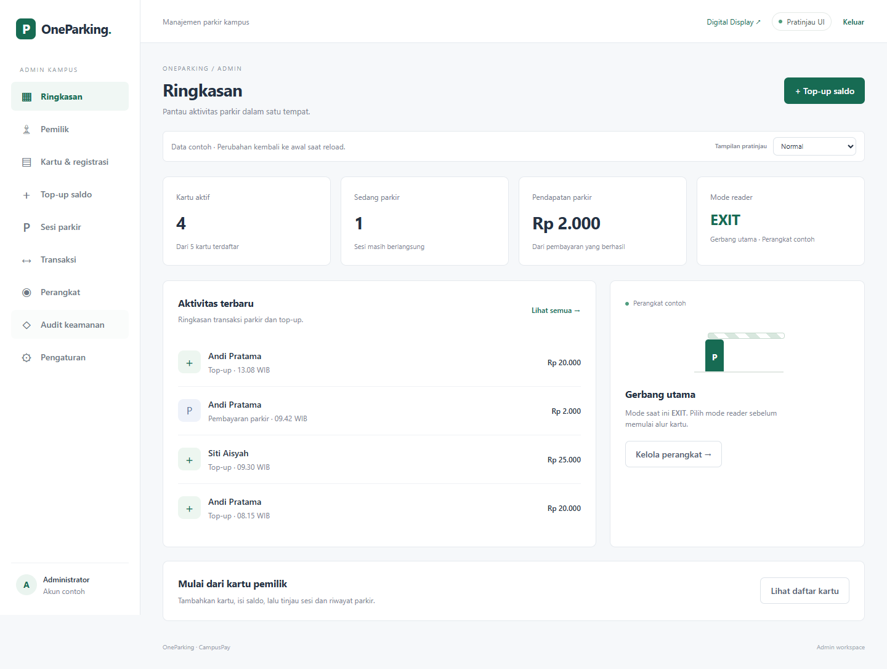
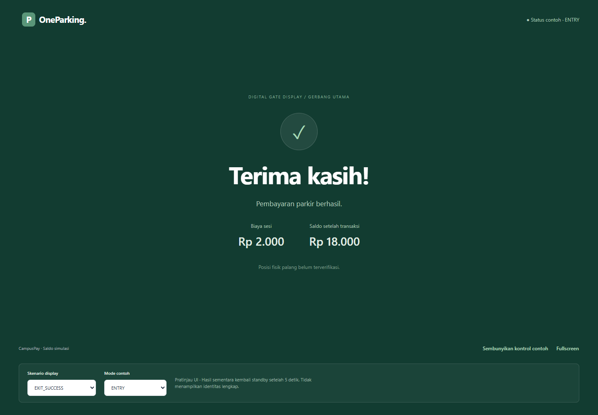

# OneParking — Struktur UI Website

Acuan lengkap antarmuka CampusPay/OneParking untuk dibagi dan dilanjutkan oleh tim. Tampilannya sederhana: sidebar, kartu ringkasan, tabel dan form, dengan layout laptop/HP.

**Branch:** `UI-Struktur-OneParking`. Git tidak mendukung spasi pada nama branch, jadi nama “UI Struktur OneParking” ditulis memakai tanda hubung.

**Batas:** seluruh data dan login adalah simulasi di memori browser. Tidak ada database, API, backend, token perangkat, atau kendali palang nyata. Reload mengembalikan data dan sesi demo. Jangan memakai akun contoh sebagai autentikasi produksi.

## Jalankan

```bash
git clone --branch UI-Struktur-OneParking https://github.com/macktheo/OneParking.git
cd OneParking/admin-web
npm ci
npm run dev
```

Di PowerShell gunakan `npm.cmd` bila `npm.ps1` diblokir. Buka URL Vite, biasanya `http://127.0.0.1:5173`.

Login contoh: **admin@oneparking.test** / **demo12345**. Ini bukan kredensial nyata dan tidak dikirim ke server.

```bash
npm run build
npm run preview
```

## Seluruh halaman

| Area    | Route                  | Acuan                                                                    |
| ------- | ---------------------- | ------------------------------------------------------------------------ |
| Login   | `/login`               | Form email/password, lihat password, loading, login gagal, sesi demo     |
| Admin   | `/admin/dashboard`     | Statistik dan aktivitas terkini                                          |
| Admin   | `/admin/users`         | Pemilik, pencarian, edit nama/NIM/kendaraan                              |
| Admin   | `/admin/cards`         | Registrasi contoh, daftar UID, pencarian/filter, konfirmasi blokir/aktif |
| Admin   | `/admin/topup`         | Pilih kartu, nominal, tinjau, konfirmasi dan hasil simulasi              |
| Admin   | `/admin/parking`       | Sesi aktif/selesai dan snapshot tarif contoh                             |
| Admin   | `/admin/transactions`  | Ledger contoh, saldo awal/akhir, pencarian/filter jenis/tanggal          |
| Admin   | `/admin/devices`       | Mode REGISTER/TOPUP/ENTRY/EXIT dan status contoh                         |
| Admin   | `/admin/security-logs` | Audit, pencarian dan filter hasil                                        |
| Admin   | `/admin/settings`      | Tarif, durasi dan batas top-up                                           |
| Display | `/display`             | Layar gerbang fullscreen dan seluruh skenario hasil PRD                  |
| Sistem  | `/forbidden`           | Halaman contoh 403                                                       |
| Sistem  | Route tidak dikenal    | Halaman 404                                                              |

Setiap halaman admin menyediakan kontrol **Tampilan pratinjau** untuk melihat normal/loading/kosong/error/offline. Digital display memiliki pemilih skenario; hasil sementara kembali standby setelah 5 detik.

## Struktur kerja

```text
admin-web/src/
├── App.vue                       # root dan provider data contoh
├── main.js                       # Vue + router
├── router/index.js               # route dan guard sesi demo
├── layouts/AdminLayout.vue       # layout seluruh halaman admin
├── components/                   # sidebar, header, stat, badge, notice, state, dialog
├── pages/
│   ├── auth/LoginPage.vue
│   ├── admin/                    # sembilan halaman admin terpisah
│   ├── display/GateDisplayPage.vue
│   └── system/                   # 403 dan 404
├── stores/                       # data/interaksi demo dan sesi RAM
├── mocks/                        # fixture kartu, transaksi dan state display
└── styles/base.css               # gaya bersama dan responsif
```

Mulai dari [peta UI dan state](docs/UI_SITEMAP.md), lalu [panduan handoff dan pembagian kerja](docs/UI_HANDOFF.md). [Hasil verifikasi](docs/UI_VERIFICATION.md) menjelaskan yang sudah diuji dan batasnya.

Tidak ada portal mahasiswa/pemegang kartu, payment gateway, kamera, atau aplikasi mobile karena berada di luar baseline MVP PRD. Pemegang kartu memakai Digital Gate Display; akun non-admin direpresentasikan melalui halaman contoh 403.

Untuk hosting statis, konfigurasi fallback semua route SPA ke `index.html`; Vue Router menggunakan history mode. Backend/proyek lain dalam laptop tidak diubah oleh branch UI ini.

## Pratinjau




