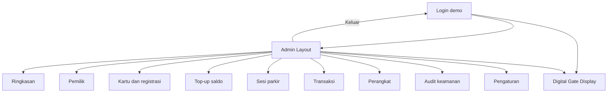

# Peta UI OneParking

## Navigasi

## Komponen bersama

| Komponen        | Digunakan untuk                                         |
| --------------- | ------------------------------------------------------- |
| `AppSidebar`    | Navigasi seluruh halaman admin, indikator halaman aktif |
| `AppHeader`     | Tautan display, label pratinjau dan keluar              |
| `StatCard`      | Statistik dashboard                                     |
| `StatusBadge`   | Status pemilik dan hasil audit                          |
| `NoticeBanner`  | Pesan hasil aksi/validasi                               |
| `PageState`     | Loading, kosong, gagal, offline pada admin              |
| `ConfirmDialog` | Konfirmasi ubah status kartu, fokus modal dan Escape    |
| `AdminLayout`   | Shell, heading route, kontrol state dan RouterView      |

## State halaman

- Login: form normal, password terlihat/tersembunyi, loading singkat, kredensial contoh salah, sukses dan logout.
- Daftar admin: normal, pencarian/filter tidak cocok, kontrol loading/kosong/error/offline.
- Kartu: formulir tambah, validasi UID, UID unik, saldo awal nol, modal batal/konfirmasi blokir/aktif.
- Pemilik: edit identitas, simpan/batal, pencarian.
- Top-up: kartu aktif/diblokir, nominal invalid, tinjau, batal, konfirmasi, sukses dan saldo/ledger contoh diperbarui. Mengubah kartu/nominal membatalkan tinjauan lama.
- Audit: hasil berhasil/ditolak, pencarian, aksi contoh yang dicatat di RAM.
- Sistem: akses ditolak 403 dan alamat tidak ditemukan 404.

## Seluruh skenario display PRD

`STANDBY`, `PROCESSING`, `ENTRY_SUCCESS`, `EXIT_SUCCESS`, `REGISTER_SCAN`, `TOPUP_SUCCESS`, `UNKNOWN_CARD`, `BLOCKED_CARD`, `INSUFFICIENT_BALANCE`, `INVALID_SESSION`, `ERROR`, `OFFLINE`.

Display tidak menampilkan UID, NIM atau nama pemilik lengkap. Biaya/saldo hanya pada skenario relevan. Hasil sementara kembali STANDBY setelah 5 detik; PROCESSING dan OFFLINE tetap sampai skenario diganti. Posisi fisik palang selalu dinyatakan belum terverifikasi. Fullscreen memakai API browser bila tersedia.

Kontrol **Skenario display** dan **Mode contoh** khusus untuk review UI. Belum ada polling/network atau keterhubungan tab. Tab browser baru mempunyai state demo sendiri.

## Alur tinjauan

1. Login contoh → dashboard.
2. Kartu → tambah → cari → konfirmasi/batalkan blokir.
3. Pemilik → edit identitas → tinjau hasil pada daftar kartu.
4. Top-up → pilih kartu aktif → pilih nominal → tinjau → konfirmasi → riwayat transaksi.
5. Perangkat → ubah mode contoh → lihat mode di dashboard.
6. Pengaturan → ubah batas top-up → tinjau validasi nominal.
7. Audit → filter penolakan → cari aktor/request ID contoh.
8. Display → tinjau semua skenario → cek auto-clear dan fullscreen.
9. Tinjau kondisi kosong/loading/error/offline dan layout HP.

Tidak semua alur di atas adalah transaksi server. Tidak ada saldo nyata, keamanan UID, replay protection, row locking atau kontrol fisik yang dibuktikan oleh prototipe frontend.
